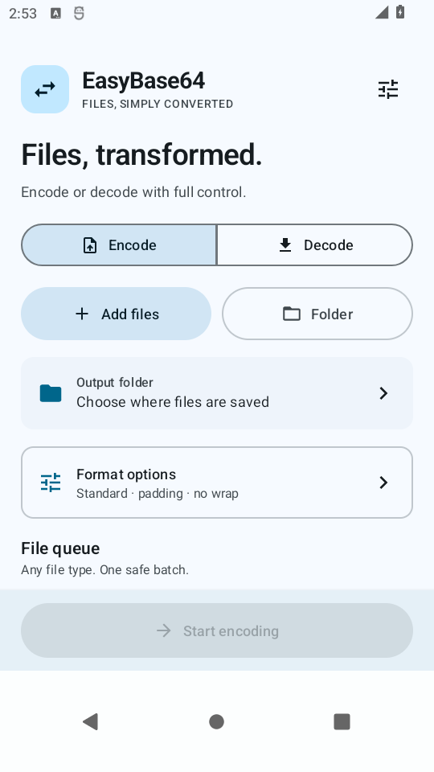
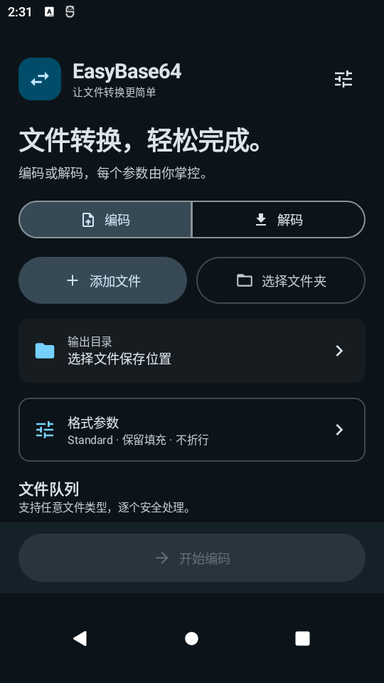
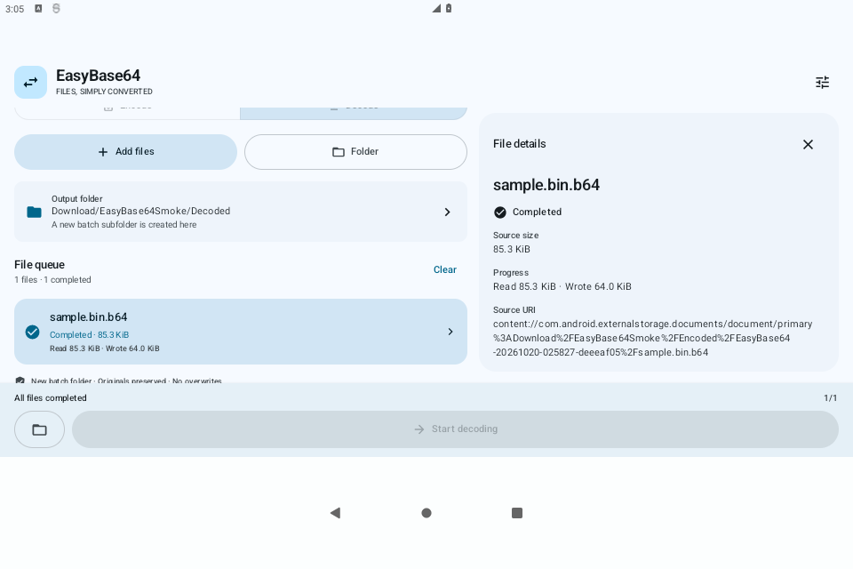

# EasyBase64

[English](README.en.md) · 简体中文

面向 Android 12 及以上系统的原生文件 Base64 编解码工具。支持任意文件、多选批处理和文件夹扫描，以流式方式处理内容，并逐文件记录结果。

**开发者：Orbis 和 Codex**

## 功能

- **文件批处理**：多选文件，或扫描单个文件夹；可包含子目录并保留相对目录层级。
- **可配置编码**：Standard / URL-safe、保留或省略填充、每行 0 / 64 / 76 字符、LF / CRLF、末尾换行，以及 CERTIFICATE 文本包装。
- **严格解码**：独立控制正文空白、CERTIFICATE 包装识别和省略填充；校验填充位、边界与完整输入尾部。
- **保护输出**：每批新建输出目录，重名自动编号；源文件和已有输出不被覆盖。失败或取消时清理未完成文件，并记录清理失败的位置。
- **任务可追踪**：显示逐文件状态、已读/已写字节和错误详情；支持取消扫描、取消转换，以及手动重试失败、取消或中断的任务。
- **原生界面**：Kotlin、Jetpack Compose、Material 3 和 Material 3 Adaptive；支持简体中文 / English、系统动态配色、跟随系统 / 浅色 / 深色主题，以及按可用窗口尺寸调整的单栏 / 双栏布局。
- **无应用联网**：不声明 `INTERNET` 权限，无账号、广告、遥测或自建后端。

Base64 是编码方式，不是加密。CERTIFICATE 包装仅是文本封装，不代表内容为有效证书。

## 界面预览

| English · 浅色 | 简体中文 · 深色 |
| --- | --- |
|  |  |



更多截图见 [docs/screenshots](docs/screenshots)。截图来自模拟器；实际颜色随系统动态配色变化。

## 安装

1. 打开本仓库的 **Releases**，选择所需版本。
2. 下载 `EasyBase64-1.0.0-universal.apk`，或对应版本的 `EasyBase64-<版本>-universal.apk`。
3. 在 Android 设备上打开 APK；若系统提示，允许当前浏览器或文件管理器安装应用。

需要 **Android 12 / API 31 或更高版本**。一个 universal APK 同时包含 `arm64-v8a`、`armeabi-v7a`、`x86` 和 `x86_64` 所需库，无需另选 v8a / v7a 安装包。包名为 `com.orbis.easybase64`。

安装前可将 APK 的 SHA-256 与对应 Release 的校验文件对照。具备 Android SDK Build Tools 时，也可检查签名：

```sh
sha256sum EasyBase64-1.0.0-universal.apk
"$ANDROID_HOME/build-tools/37.0.0/apksigner" verify --verbose --print-certs EasyBase64-1.0.0-universal.apk
```

现有版本的签名指纹和 APK 校验记录见 [测试报告](docs/TEST_RESULTS.md)。**后续覆盖更新必须使用与已安装版本相同的签名密钥**。Debug 或自行签名的 APK 可能使用不同证书，不能直接覆盖原发布版。

## 使用

1. 选择 **编码** 或 **解码**，再选择输出目录。
2. 点击 **添加文件** 多选输入，或选择一个文件夹；需要递归时开启 **包含子目录**。扫描文件夹前须先确定输出目录。
3. 检查队列和 **格式参数**，移除不需要的文件，然后开始处理。
4. 在队列中查看结果；点击文件可查看完整名称、URI、错误和尝试记录。完成后可打开输出目录。
5. 失败、取消或中断的文件可以手动重试。重试使用该批次最初保存的参数；如需更改参数，请建立新批次。

任务执行期间，当前批次的参数和文件清单被冻结。一个文件失败不会阻断后续文件。取消时界面会等待文档提供方结束读写与清理；已经完成的结果会保留。

### 输出规则

| 输入情况 | 输出命名 |
| --- | --- |
| 编码 `report.pdf` | `report.pdf.b64` |
| 解码 `report.pdf.b64` | `report.pdf` |
| 解码不带 `.b64` 后缀的 `input.txt` | `input.txt.decoded` |

`.b64` 后缀判断不区分大小写；解码依据文件内容，不限制输入扩展名。所有输出均位于所选目录下的新批次子目录中。多选模式平铺输出；文件夹模式保留相对目录。若输出目录位于输入树内，扫描会排除输出子树；无法可靠确认目录关系时，会要求更换输出位置。

清空队列仅删除任务元数据，不删除源文件、已完成输出或残留文件。存在未完成输出时，请先查看详情并处理清理记录。

### 格式约定

| 项目 | 行为 |
| --- | --- |
| 字母表 | 显式选择 Standard 或 URL-safe，不自动猜测或混用。 |
| 编码默认值 | Standard、保留 `=`、不折行、不添加末尾换行、无包装。 |
| CERTIFICATE 编码 | 固定 Standard、保留填充、64 字符折行和 CRLF；不验证 X.509 证书。 |
| 解码默认值 | 忽略 SP / TAB / CR / LF、识别单个 CERTIFICATE 包装、不允许省略填充。 |
| 文本编码 | 文件开头允许单个 UTF-8 BOM；不接受 UTF-16、正文中的 BOM 或非 ASCII 字符。 |
| 严格校验 | 检查填充位置、数量、尾部长度、未使用填充位及物理 EOF；尾部垃圾、缺失边界、多块包装或标签不匹配均失败。 |

正文空白与包装识别是独立选项。正文存在折行时，即使已开启包装识别，也需要开启忽略空白。详细规则见 [设计文档](docs/DEVELOPMENT_DESIGN.md)。

## 从源码构建

安装完整 **JDK 21**、Android SDK 平台 **37.2** 和 Build Tools **37.0.0**。配置 `ANDROID_HOME`，或在未跟踪的 `local.properties` 中设置 `sdk.dir`。使用项目自带 Gradle Wrapper；无需另装全局 Gradle。Windows 下将 `./gradlew` 换成 `gradlew.bat`。

Linux x86_64 可使用已有安装脚本：

```sh
bash scripts/setup-android.sh
source .toolchains/env.sh
./gradlew :app:assembleDebug
```

Debug APK 默认位于 `app/build/outputs/apk/debug/app-debug.apk`。安装脚本支持 `EASYBASE64_TOOLCHAINS` 自定义目录；使用自定义目录时，应加载该目录生成的 `env.sh`。

| 组件 | 固定版本 |
| --- | --- |
| Gradle / Android Gradle Plugin | 9.8.2 / 9.4.1 |
| Kotlin / Compose 编译器插件 | 2.4.21 |
| Compose BOM / Material 3 Adaptive | 2026.09.00 / 1.3.0 |
| Room / KSP | 2.8.5 / 2.3.12 |
| 编译 / 目标 / 最低 SDK | 37.2 / 36 / 31 |

Android 模块使用 AGP 内置 Kotlin 支持。完整环境说明见 [工具链记录](docs/TOOLCHAIN.md)。

### Release 签名

Release 构建启用 R8 与资源压缩：

```sh
./gradlew :app:assembleRelease
```

本地 `signing.properties` 可提供签名配置，例如：

```properties
storeFile=/absolute/path/to/your-release.jks
storePassword=YOUR_STORE_PASSWORD
keyAlias=YOUR_KEY_ALIAS
keyPassword=YOUR_KEY_PASSWORD
```

缺少签名配置时，Release APK 不会自动获得发布签名。为原应用制作更新时，维护者需要使用原签名密钥。**私钥、密钥库、密码和 `signing.properties` 不应提交到 Git 或上传为公开 Release 附件**；公开证书和签名指纹可以用于核验。

## 测试与验证范围

```sh
./gradlew :core:test :data:testDebugUnitTest :app:testDebugUnitTest \
  :data:lintDebug :app:lintDebug :app:assembleDebug

# 连接可用于测试的 Android 设备或模拟器后运行：
./gradlew :data:connectedDebugAndroidTest :app:connectedDebugAndroidTest

# 独立运行大文件验证；需要约 4 GiB 临时可用空间：
./gradlew :core:largeFileBenchmark
```

系统文件选择器测试依赖英文系统界面；应用 UI 测试会分别检查英文和简体中文。建议使用专用测试模拟器。

已记录的验证包括 17 个核心 JVM 测试、3 个存储命名 JVM 测试、Android 存储与 UI 仪器测试、真实本地 SAF 提供方往返，以及**实际签名 Release APK 的安装、界面、前台服务与文件往返测试**。16 MiB 和 1 GiB 文件在 JVM 上完成流式编码、解码和独立 SHA-256 对比。App Lint 无错误，保留的警告已列入报告；App JVM 测试任务为 `NO-SOURCE`，界面测试由 Android 仪器测试承担。

Android 实测环境为 API 31、x86_64 模拟器，包含手机、低高度横屏、大字体和宽屏窗口。**未实测 ARM / ARM64 真机、云盘提供方、折叠屏硬件或所有 Android 版本**；JVM 大文件结果不代表手机 SAF 吞吐率。各轮测试对应的代码版本、补测范围与已知限制，以 [测试报告](docs/TEST_RESULTS.md) 和 [核心测试记录](docs/CORE_TEST_RESULTS.md) 为准。

## 隐私与已知限制

文件通过 Android 系统文档选择器和 Storage Access Framework（SAF）访问，不申请全盘访问权限。应用只保存 URI、参数与任务元数据，不将文件正文写入任务数据库。虽然应用没有网络权限，用户选择的云盘文档提供方仍可能在其自身进程中上传或下载文件。

转换使用平台 `java.util.Base64` 流式接口及有界缓冲；队列元数据仍会随文件数量增长。后台处理采用用户启动的 `dataSync` 前台服务和进度通知，不能保证无限后台运行。进程或服务中断后，需要重新打开应用并手动重试，不支持字节级断点续传或自动后台恢复。

SAF 提供方对重命名、持久授权和阻塞 I/O 取消的支持不同。应用先暂存、验证完整输入和流关闭，再重命名或复制提交；SAF 不统一保证原子提交。无法清理的文件或中断重命名的位置会保留供人工检查。详细说明见 [存储与恢复说明](docs/STORAGE_NOTES.md)。

本版不包含文本工作区、整文件预览、分享接收、命名预设、云同步或证书验证，也不会从 Base64 正文推断原文件名和元数据。

## 工程结构与文档

| 路径 | 内容 |
| --- | --- |
| `core/` | 纯 Kotlin/JVM 流式编解码、格式契约与测试 |
| `data/` | SAF、Room 队列与尝试记录、提交、取消和清理 |
| `app/` | Compose UI、自适应布局、系统选择器和前台服务 |
| [设计文档](docs/DEVELOPMENT_DESIGN.md) | 原始开发规格 |
| [实现决策](docs/IMPLEMENTATION_NOTES.md) | 架构和具体实现取舍 |
| [测试报告](docs/TEST_RESULTS.md) | 已执行验证与限制 |
| [第三方声明](docs/THIRD_PARTY_NOTICES.md) | 依赖组件及许可证说明 |

[GitHub 上传与发布说明](docs/GITHUB_UPLOAD.zh-CN.md)

## 许可证

本项目原创代码采用 [MIT License](LICENSE)。Copyright © 2026 Orbis and Codex。

第三方依赖保留各自的许可证与版权声明；相关组件使用的 [Apache License, Version 2.0](docs/licenses/Apache-2.0.txt) 与声明见 [第三方声明](docs/THIRD_PARTY_NOTICES.md)。
