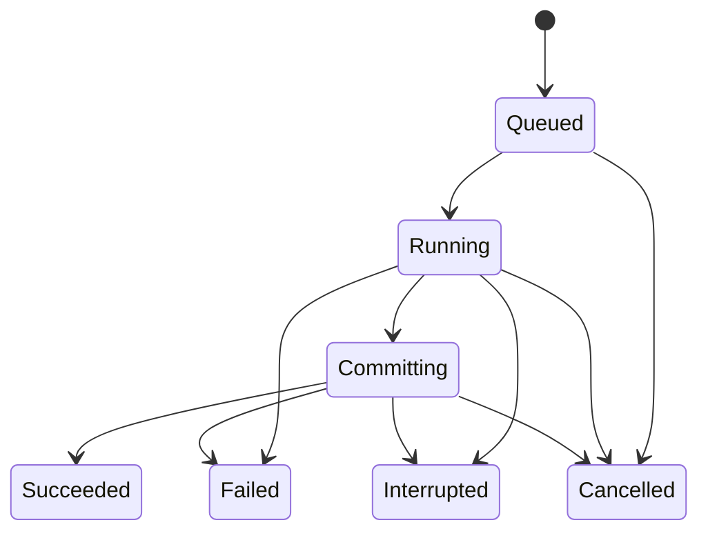

# Android Base64 客户端开发设计文档

版本：1.0 · 日期：2026-10-20 · 状态：可用于开发任务交接

本文将需求、设计决策和验收标准汇总为一份可独立使用的开发规格。范围仅涵盖 Android 客户端及其编解码能力，不包含 Windows 剪贴板功能。文中的平台能力以官方文档为依据；默认值、架构和产品取舍是本项目的设计决策，不代表平台的硬性要求。

## 1. 项目目标与关键决策

开发一个本地处理、支持任意文件、具有 Material You 界面的 Android Base64 工具。核心体验为：选择多个文件或一个文件夹，设置编解码参数与输出位置，执行批量任务，查看逐文件结果。

| 项目 | 本版决定 |
| --- | --- |
| 目标平台 | Android 12 及以上，`minSdk = 31`；不做旧系统兼容 |
| 开发语言与界面 | Kotlin、Jetpack Compose、Material 3、Material 3 Adaptive |
| 核心算法 | `java.util.Base64` 的流式 API；不自行实现 Base64 位运算算法 |
| 数据范围 | 任意二进制文件，不限图片、文本或媒体格式 |
| 文件访问 | 系统文档选择器和 Storage Access Framework（SAF） |
| 默认执行方式 | 单文件顺序处理，队列中失败项不阻断后续项 |
| 解码兼容 | 标准 / URL-safe 明确选择；正文空白与 CERTIFICATE 包装分别控制 |
| 输出保护 | 默认自动编号、不覆盖已有文件、不修改源文件 |
| 大屏布局 | 按当前窗口宽高调整单栏 / 双栏，不按设备名称或横竖屏硬编码 |
| 网络与账户 | 无应用自建后端、无账号、无广告和遥测；应用不声明 INTERNET 权限 |
| 交付形式 | 可构建的 Android 工程、Debug APK、测试结果、使用与限制说明 |

选择 Android 12 作为最低版本，是本项目为简化动态配色与平台支持作出的决定。开发时使用彼此兼容的最新稳定 Kotlin、Compose、AGP、Gradle 和 Android SDK，固定实际版本并写入 README；不因“最新”而引入预览 SDK 或不必要的实验依赖。[S1–S5]

## 2. 功能范围与非目标

### 2.1 首版必须实现（P0）

- 文件编码与文件解码：任意字节输入，输出保存为文件。
- 批量编码与批量解码：多选文件；选择文件夹并扫描直属文件，可开启包含子目录。
- 选择独立输出目录；逐文件显示名称、状态、已处理字节和错误原因。
- 标准 Base64 与 URL-safe 字母表选项。
- 编码选项：有 / 无 padding、无折行 / 64 / 76 字符折行、LF / CRLF、末尾换行。
- 解码选项：忽略正文 ASCII 空白、识别 CERTIFICATE 包装、允许省略 padding。
- 编码可选输出 certutil 风格 CERTIFICATE 包装，以便进行兼容性往返验证。
- 批量参数快照、取消任务、失败项重试、进程中断后的明确状态与人工重试。
- Material You 动态配色、明暗主题、大字体可用性、手机与大屏自适应。
- 本地 JVM 测试、Android 文件与 UI 测试、构建与交付记录。

### 2.2 可在首版之后添加（P1）

- 小文本编解码工作区与受限长度预览。
- 接收其他应用分享的文件、输出文件分享。
- 保存用户命名的参数预设、导出批量结果清单。
- 可配置的有界并发、按文件大小或类型筛选、输出 SHA-256 展示。

### 2.3 本版不做

- 真正的 X.509 证书验证、私钥解析、加密算法、压缩算法。
- 自动猜测并混用 Base64 标准字母表与 URL-safe 字母表。
- 任意 MIME 邮件、任意 PEM 标签、多块 PEM 拼接、Data URI 自动剥离。
- 整文件文本预览、将 GB 级结果复制到剪贴板。
- 字节级断点续传、无条件永久后台运行、云端同步。
- 自动恢复 Base64 中并不存在的原文件名、扩展名或文件元数据。
- 发布商店、公开仓库、正式签名密钥管理或自动发布 Release。

“无应用网络权限”指应用自身不建立网络连接。若用户选择了云盘文档提供方，提供方可能在其自身进程中下载或上传文件；界面不得因此宣传所选云盘文件也完全不经过网络。

## 3. 用户流程与界面设计

### 3.1 主流程

1. 选择“编码”或“解码”。
2. 添加文件，或选择文件夹并决定是否包含子目录。
3. 扫描完成后预览队列；移除不需要的项，确认输出目录。
4. 调整参数；界面显示一条简明参数摘要。
5. 点击“开始”，冻结本批参数与文件清单。
6. 查看总任务数量、当前文件字节进度和逐文件结果。
7. 完成后打开输出目录，或只重试失败 / 中断项。

扫描阶段本身必须可取消。目录扫描结束前不开始写输出；输出目录及其子树若位于输入树内，应排除在本次扫描之外，避免再次编码已有结果。无法可靠判断目录关系时，要求另选输出目录并说明原因。

### 3.2 Material You

- 使用 `MaterialTheme`、Material 3 的颜色角色、排版与组件；不要以大量自绘控件替代已有组件。
- Android 12+ 使用系统动态明暗配色；主题设置提供“跟随系统 / 浅色 / 深色”。
- 文件行显示文件名、状态和大小；长文件名可截断，但详情页必须能够查看完整名称。
- 状态同时使用文字与图标，不仅依赖颜色；按钮有可访问名称和合理触控区域。
- 错误显示“原因 + 下一步”，例如“输出目录授权失效，请重新选择”。
- 内容避开系统栏、输入法与折叠屏遮挡区域；支持 edge-to-edge 下正确的 insets。

### 3.3 自适应布局

优先采用 Material 3 Adaptive 的 list-detail 模式：[S4–S5]

| 窗口条件 | 布局行为 |
| --- | --- |
| 紧凑窗口 | 单栏队列；点击文件进入详情；参数放在独立页面或可展开区域 |
| 宽度和高度足够 | 左侧队列、右侧文件详情与参数；保留当前选中项 |
| 宽但高度不足 | 使用可滚动的紧凑布局；不机械地因横屏进入双栏 |
| 分屏 / 窗口拖动 / 折叠变化 | 根据实际窗口信息重排；不重启正在运行的批次 |

使用 `currentWindowAdaptiveInfo()` 等当前稳定 API 获取窗口信息；双栏可采用 `NavigableListDetailPaneScaffold`。业务状态不存放在可随重组重建的局部 UI 对象中。

## 4. 编解码格式契约

### 4.1 编码参数

| 参数 | 候选值 | 默认值 |
| --- | --- | --- |
| Alphabet | Standard / URL-safe | Standard |
| Padding | 保留 `=` / 省略 | 保留 |
| Wrap width | 0 / 64 / 76 | 0，即不折行 |
| Line ending | LF / CRLF | LF；无折行且无末尾换行时不生效 |
| Final newline | 开 / 关 | 关 |
| Envelope | None / CERTIFICATE | None |

Standard 使用 `A–Z a–z 0–9 + /`；URL-safe 使用 `- _` 替换 `+ /`。编码输出采用 ASCII，可作为 UTF-8 文本读取；不输出 BOM。

无包装时，仅在仍有后续正文字符时插入折行分隔符。`Final newline = 关` 时，即使正文恰好为 64 / 76 字符也不追加尾换行；开启时，对非空正文恰好追加一个选定分隔符。空输入在无包装模式下始终输出空文件，不因末尾换行选项产生内容。

`Envelope = CERTIFICATE` 时，为避免矛盾组合，强制 Standard、保留 padding、正文每 64 字符 CRLF；输出结构为：

```text
-----BEGIN CERTIFICATE-----\r\n
<Base64 正文，每 64 字符 CRLF>\r\n
-----END CERTIFICATE-----\r\n
```

非空正文与 END 边界之间恰好一个 CRLF；若折行器已在正文末尾写出 CRLF，不重复追加。空输入时正文为空，直接在开头边界之后写结束边界。产品文案称“CERTIFICATE 包装”，并说明这里只是文本封装，不保证内容是真正的证书。

库只负责 Base64 正文；URL-safe 的折行和包装等外围格式由有界缓冲的输出过滤器完成。过滤器只插入行分隔符，不重新实现编码算法。

### 4.2 解码参数

| 参数 | 默认值 | 精确定义 |
| --- | --- | --- |
| Alphabet | Standard | 由用户选择，不自动接受混合字母表 |
| Ignore ASCII whitespace | 开 | 只忽略正文中的 SP、TAB、CR、LF |
| Recognize CERTIFICATE envelope | 开 | 接受纯正文，或单个匹配的 CERTIFICATE 包装块 |
| Allow omitted padding | 关 | 关闭时要求非空正文长度为 4 的倍数且 padding 合法；开启时允许规范的无 padding 尾部 |

文件起始位置允许单个 UTF-8 BOM，以便读取常见文本文件；此规则独立于空白开关。其他位置的 BOM、非 ASCII 正文和 UTF-16 输入均返回明确的格式错误，不猜测或自动转码。

正文空白开关关闭时，纯正文中的任何 SP / TAB / CR / LF 都应报错。包装已开启时，边界自身的行结束符属于容器语法；移除边界后，正文内部的空白仍由该开关决定。因此，带折行的 certutil 正文需要同时开启这两个选项。

### 4.3 包装解析规则

- 仅支持完整的 `-----BEGIN CERTIFICATE-----` / `-----END CERTIFICATE-----`。
- 边界必须独占一行；可允许边界行首尾的 SP / TAB；行结束允许 LF 或 CRLF，结束边界后也可直接 EOF。
- 包装前后只允许 SP / TAB / CR / LF；不能忽略说明文字或其他垃圾。
- 输入只能是纯正文，或一个包装块。缺失边界、标签不匹配、嵌套块、第二个块均报错。
- 包装识别关闭时，不剥离任何边界；带包装输入应失败。
- 识别到包装但 Alphabet 为 URL-safe 时，返回配置不匹配错误。
- 不能通过删除所有非字母表字符实现容错。`BEGINCERTIFICATE` 本身含合法 Base64 字母，交给 MIME 解码器仍可能被当作数据。[S1, S11]

### 4.4 Padding 与文件结束规则

- `=` 只能在正文末尾出现，数量和位置必须符合 Base64 规则。
- 允许省略 padding 时，无 padding 尾部有效字符数模 4 只能为 0、2 或 3；余数 1 必须失败。
- 不通过任意补删 `=`、跳过非法字符或混合字母表来“修好”输入。
- 要求最后一个有效分组的未使用填充位为零；结构校验器检查该规则，实际字节转换仍由平台库完成。
- **成功条件必须包含扫描到输入物理 EOF。** 流式解码器遇到 padding 后可能停止读取；应用仍须验证剩余输入和结束包装，拒绝 padding 后的额外正文、第二块或垃圾。
- 任何尾部校验失败都撤销本文件的成功状态，执行输出清理；不能将“已经写出一部分字节”视为成功。

## 5. 流式处理与存储安全

### 5.1 数据通路


编码方向使用输入流、平台编码输出流和可选格式输出过滤器。解码方向使用增量解析 / 校验器提供正文输入流，再由平台解码流产生二进制。接口必须提供显式的输入结束验证，不以 `close()` 代替格式校验。

### 5.2 有界内存要求

- 默认数据缓冲区 64 KiB，允许基准测试后调整为固定大小。
- 禁止在文件转换路径调用整文件 `readBytes()`、`readText()`、构造整文件 String / ByteArray。
- 禁止用 `readLine()`读取任意长正文；无折行 Base64 可能整份文件只有一行。
- 包装识别使用增量状态机和有限候选缓存。仅在已经匹配包装边界前缀时缓存候选，边界候选上限为 256 字节；超限返回边界过长错误。纯正文立即逐块传递，不以正文行长作为限制，不缓存无限长的前导空白。
- 不缓存完整正文，不把整个输出放入 Compose 状态、数据库字段或 WorkManager Data。
- 单文件转换的额外内存应主要随缓冲区大小变化，不随文件大小线性增长；批量元数据会随文件数量增长，需分页或增量呈现。
- 字节数使用 64 位整数；进度未知时显示已处理字节和不确定进度，不使用 `InputStream.available()` 推算文件总长。

### 5.3 SAF 与 URI

- 多选采用 `OpenMultipleDocuments`；目录采用 `OpenDocumentTree`；以 `ContentResolver` 打开流。[S6–S7]
- 不能假设 URI 对应普通文件路径，也不能通过字符串拼接制造子 URI。
- 按实际授予的标志获取可持久化 URI 权限；权限持久化失败时说明影响并限制恢复承诺。
- 源可能来自云盘、管道或不可 seek 流；处理文件大小未知、短读、断连和权限撤回。
- 每个批次只接受“多选文件”或“单一目录树”一种输入来源，简化相对路径语义。
- 目录模式递归时保留源树相对目录；多选模式使用平铺输出。所有输出均放在用户选定目录下的新建批次子目录中。
- 大量目录枚举优先批量读取所需元数据；若 `DocumentFile` 查询开销明显，使用 `DocumentsContract`。[S8]

### 5.4 输出命名和提交

1. 编码默认追加 `.b64`，例如 `report.pdf` → `report.pdf.b64`；包装编码也保留这一命名规则。
2. 解码移除末尾 `.b64`（大小写不敏感）；没有该后缀则追加 `.decoded`。名称为空时用 `decoded.bin`。
3. 不以输入扩展名限制能否解码；`.txt`、`.b64` 和其他后缀均允许，依据内容验证。
4. 文件名不得包含用于逃出输出目录的路径片段。相对层级来自授权目录树，不来自不可信文件内容。
5. 默认通过编号避免重名；首版不提供覆盖模式。记录文档提供方实际返回的显示名和输出 URI。
6. 输出先使用唯一暂存名称，例如 `name.<task-id>.partial`。完整解析、复制和所有必要的 flush / close 成功后，才进入完成提交阶段。
7. 提供方支持重命名时尝试重命名；不支持时，向新建的最终目标复制，再验证写入关闭成功。不得覆盖源或旧输出。每次尝试在获得 URI 后及时持久化暂存 URI、最终目标 URI 及提交阶段。复制式提交完成后删除暂存；删除失败保留成功结果，同时报告残留，不能无提示丢弃清理状态。
8. SAF 并不统一保证原子重命名 / 原子提交。若中断发生在提交阶段，结果标记为中断或未验证，并在下次进入时检查可访问性，提供清理 / 重试。
9. 失败或取消时清理本任务新建的暂存 / 未完成输出；清理失败必须显示残留位置。只有完整提交成功后才计入成功数量。

## 6. 应用架构与数据模型

采用小型分层工程，避免为了架构拆出大量空模块。建议三个 Gradle 模块：

| 模块 | 职责 | 可测试性 |
| --- | --- | --- |
| `:core` | 配置、包装解析器、结构校验器、编解码流水线、进度接口 | 纯 Kotlin/JVM，不依赖 Android Context；可在云端直接测试 |
| `:data` | SAF 访问、输出提交、Room 队列持久化、DataStore 偏好 | 以接口替换存储后可做故障注入；真实 SAF 需 Android 测试 |
| `:app` | Compose UI、ViewModel、任务协调、前台服务、导航 | Compose UI 和生命周期测试 |

工程可使用轻量手工依赖注入；没有实际需要时不添加大型 DI 框架。UI 通过 StateFlow 观察状态，不直接拥有输入流或调用编解码循环。

建议数据结构：

| 对象 | 最小字段 |
| --- | --- |
| `CodecOptions` | 操作方向、字母表、padding、折行、换行符、包装与空白策略；不可变 |
| `Batch` | ID、创建时间、参数快照、输出根 URI、状态、汇总 |
| `FileTask` | ID、源 URI、原显示名、相对路径、可空文件大小、输出 URI、状态 |
| `TaskAttempt` | 尝试 ID、关联任务、暂存 URI、最终目标 URI、提交阶段、起止时间、清理状态与残留 URI |
| `TaskProgress` | 已读 / 已写字节、可空总字节、当前阶段；使用 Long |
| `TaskFailure` | 稳定错误码、用户提示、可重试标志、可选原始字节偏移 |

持久化源 URI、配置与结果元数据，不持久化正文或原始二进制。异常日志不输出文件内容；清除记录仅清除任务元数据，不删除用户源文件或已完成文件。

## 7. 批量执行、取消与生命周期

### 7.1 状态机



重试创建新的执行尝试并保留上一尝试结果，不将原错误覆盖成“从未发生”。启动时数据库中仍为 Running / Committing 的孤立项标记 Interrupted，不假定已完成。

### 7.2 调度规则

- 一个批次默认一次处理一个文件；运行期间不能更改该批参数或源清单。
- 文件失败后继续下一个；批次汇总区分“全部成功 / 部分失败 / 已取消 / 已中断”。
- 用户取消后停止启动新项；正在复制的项在缓冲区边界检查取消并尽快结束。
- 提交阶段的复制也允许取消，并清理本次尝试创建的未完成目标和暂存项。已完整提交的文件保持成功；取消不删除此前成功结果。完成提交与取消的竞争由单一任务执行器串行决定并持久化。
- 对阻塞的文档提供方，尝试关闭活动流以解除读取；不能保证所有提供方即时响应，UI 显示“正在取消”而非立即声称完成。
- 避免每处理一个字节更新数据库或 UI；进度可约每 100–250 ms 聚合一次，状态转移及时持久化。
- 旋转、分屏和 Compose 重组不得重复启动任务或重建批次。

### 7.3 后台策略

首版采用用户点击“开始”时启动的可见任务执行器；需要持续处理时使用适用的 `dataSync` 前台服务，显示进度和取消操作。遵守目标 SDK 对前台服务类型、权限、启动时机和超时的要求。[S9–S10]

不承诺无限后台运行。因系统回收、服务超时或用户强制停止中断时，持久化状态并在下次打开后提示重试。首版不在重启设备或应用恢复时擅自重新开始大批文件写入。

不要仅因为任务很长就套用 WorkManager 并承诺一定完成。Android 16 起长时间运行的 worker 也可能耗尽 JobScheduler 配额；未来如使用 WorkManager，应重新核对具体适用性。[S9]

## 8. 错误分类与用户反馈

| 错误码示例 | 展示含义 | 默认动作 |
| --- | --- | --- |
| `INVALID_CHARACTER` | 正文出现非当前字母表字符；提供偏移（可得时） | 该文件失败，继续下一项 |
| `INVALID_PADDING` | padding 数量、位置、尾部长度或填充位无效 | 失败，不自动修复 |
| `ENVELOPE_MISMATCH` | 包装缺失、不匹配、嵌套或有多个块 | 失败，提示检查包装设置 |
| `TRAILING_DATA` | 结束后仍存在不允许的数据 | 失败并清理输出 |
| `UNSUPPORTED_TEXT_ENCODING` | BOM / 字节模式表明不是支持的 ASCII / UTF-8 文本 | 提示先转换文本编码 |
| `SOURCE_UNAVAILABLE` | 文件消失、断连或读取失败 | 可在来源恢复后重试 |
| `PERMISSION_LOST` | 输入或输出 URI 权限失效 | 重新选择文件或目录 |
| `WRITE_FAILED` | 创建、写入、flush / close 或提交失败 | 清理输出，显示提供方错误摘要 |
| `SPACE_INSUFFICIENT` | 提供方明确报告空间不足 | 提示更换输出位置或释放空间 |
| `CLEANUP_FAILED` | 未完成文件无法清理 | 显示残留 URI 对应名称与位置 |
| `INTERRUPTED` | 上次执行未正常结束 | 用户确认后重试该文件 |

没有明确证据时，不把任意 IOException 都归类为“磁盘满了”。保持用户错误提示简短，可展开查看技术摘要。

## 9. 测试计划与验收标准

### 9.1 核心功能测试（云端可运行）

| 编号 | 场景 | 通过条件 |
| --- | --- | --- |
| C01 | RFC 4648 标准向量、空文件、1 / 2 / 3 字节及任意二进制 | 编码匹配标准向量；往返字节完全一致 |
| C02 | Standard / URL-safe、padding 开关、64 / 76 折行、LF / CRLF | 输出精确匹配配置；标准与 URL-safe 混用被拒绝 |
| C03 | 正文空白与包装开关四种组合 | 严格遵守第 4 节，关闭的容错不偷偷生效 |
| C04 | certutil 风格包装、末尾空行、文件首 UTF-8 BOM | 在相应设置下成功；块外文字和中间 BOM 失败 |
| C05 | 缺失 END、标签不匹配、嵌套、多块 | 全部失败，不能保留成功输出 |
| C06 | 正确 / 错误 padding、无 padding 尾部、非零填充位 | 按契约接受或拒绝；不任意补删字符 |
| C07 | padding 后追加正文、垃圾或第二个块 | 即使解码器提前停止也必须检测失败 |
| C08 | 每次只返回 1 字节和不规则短读的输入流 | 边界、CRLF、BOM、四字符组跨缓冲区仍正确 |
| C09 | 无折行超长正文，跨 64 KiB 边界与边界前后长度 | 不整行载入；转换结果一致 |
| C10 | 读取 / 写入 / flush / close 失败及取消 | 状态正确；不覆盖源和已有目标；残留可追踪 |

除往返测试外，必须有独立标准向量或已知正确实现的交叉对照，防止编码器和解码器以同一种错误相互抵消。[S12]

### 9.2 Android 集成与界面测试

- 实际 SAF 多选、递归文件夹、独立输出目录、同名文件、无扩展名和非 ASCII 文件名。
- 一个坏文件混在多个正常文件中：正常文件仍完成，汇总计数正确。
- 旋转、分屏、窗口缩放、返回前台：不重复执行，选中项与任务状态可恢复。
- 进程被杀、服务停止、重新启动：未完成项明确标记，成功项不重复写入。
- 未知文件大小、不可 seek、权限失效、输出失败使用测试提供方或适配器模拟；至少对一个真实本地提供方做端到端验证。
- 手机紧凑布局、宽屏双栏、横屏低高度、大字体、明暗动态色和 TalkBack 标签。
- 云盘提供方属于兼容性测试扩展；未测试时明确记录，不声称全提供方兼容。

### 9.3 大文件与批量质量门槛

- 在具备存储空间的环境中，对至少 1 GiB 的确定性生成文件执行编解码；对比源与恢复文件 SHA-256。
- 数据生成、转换、哈希都必须流式执行，避免测试工具自身整文件读入。
- 在同一设备 / 进程配置下比较不同文件大小的内存轨迹：不得因正文长度产生线性增长的常驻缓冲或字符串；记录峰值内存与设备信息，不虚构固定性能数字。
- 至少 100 个小文件的批量测试，包含重名、坏输入、空文件、取消和重试。
- 性能指标先测量后承诺；未提供基准结果前不写“零内存占用”“无限大小”或固定吞吐率。

## 10. 实施顺序与完成定义

| 阶段 | 实施内容 | 退出条件 |
| --- | --- | --- |
| M1 | 工程骨架、版本锁定、纯 JVM 核心、格式解析与测试 | 核心测试通过；没有 Android 依赖污染核心模块 |
| M2 | SAF 输入输出、单文件处理、暂存与提交、失败清理 | 一个真实文件往返成功；错误路径可复现 |
| M3 | 批量队列、状态持久化、取消与重试、后台执行 | 混合成功 / 失败批次正确；进程中断可解释 |
| M4 | Material You、自适应界面、无障碍和状态呈现 | 紧凑 / 扩展窗口可用；旋转不重启任务 |
| M5 | 集成验证、大文件基准、文档、APK | 实际构建与测试结果完整；限制明确 |

完成交付至少包含：

1. 本文存放在工程 `docs/DEVELOPMENT_DESIGN.md`。
2. 可复现的 Gradle 工程与 Wrapper，固定依赖版本。
3. README：构建、运行、最低系统、参数语义、输出规则、已知限制。
4. 已执行的构建 / 测试命令及结果；至少尝试核心单测、Android 单测、Lint、Debug APK 构建。
5. 如环境具备 SDK：执行 `./gradlew :core:test :app:testDebugUnitTest :app:lintDebug :app:assembleDebug`；依赖模块自身测试也必须执行。
6. 模拟器 / 真机可用时执行 instrumented tests，并保存手机和大屏截图；没有设备时明确写“未实测”。
7. Debug APK 路径、构建日志摘要与未解决事项。不能仅交付界面 mock 或演示字符串转换。

若云环境无法安装 Android SDK 或下载依赖，仍应完成可离线完成的源码与纯 JVM 测试；最终列明具体阻碍，不声称构建通过，也不静默降级为网页 App。

## 11. 可直接交给 Codex Cloud 的任务指令

将以下指令与本文全文一并提交；本节不要求云端代理访问先前聊天记录。

```text
请按照随附《Android Base64 客户端开发设计文档》实现可构建的原生 Android 应用。

目标是任意文件的批量 Base64 编解码工具，minSdk 31，Kotlin + Jetpack Compose + Material 3 + Material 3 Adaptive。以文档中的格式契约、失败处理和验收标准为准；算法复用 java.util.Base64 的流式接口。

先检查当前仓库、AGENTS.md 和可用工具链。若是空仓库，在当前任务工作区创建新工程；若已有不相关项目，避免覆盖，使用清晰的独立子目录并说明。把设计文档保存为 docs/DEVELOPMENT_DESIGN.md。

依次完成 M1–M5，不要停在计划、UI 原型或只能处理字符串的演示。合理的小实现决策自行处理并记录；不添加无关功能。

必须落实：流式且有界内存；多选和目录批量；独立包装 / 空白开关；完整 EOF 校验；不覆盖已有文件；失败和取消清理；逐文件结果；动态配色和大屏布局。文件转换路径禁止整文件 readBytes/readText，也禁止 readLine 读取任意长的单行正文。

不得用 MIME 解码器的宽松跳过代替包装解析。Decoder.wrap() 结束后仍须确保包装和输入尾部被完整验证。必须通过标准向量、短读边界、坏 padding、第二块、尾部垃圾和输出失败等测试。

使用当前可用的稳定依赖组合，固定版本。尝试实际单测、Lint 和 Debug APK 构建；若可用设备，再做 UI / SAF 测试。缺 SDK、网络或设备时记录准确失败原因，继续完成可完成的工作，不伪称通过。

最终提供代码变更摘要、构建和测试命令及结果、APK 路径（若生成）、已知限制与下一步。不要提交到应用商店、公开发布仓库、创建正式发布签名密钥或部署后端；这些不属于本次开发。
```

## 12. 本次云端交接状态

- 已检查当前可用连接器和命令行入口，未发现可直接创建 Codex Cloud 任务的专用接口，当前工作区也无可用 Codex CLI。
- 已通过 Codex 官方网页的“试用网页版”入口尝试进入云端工作区；页面显示“登录或注册”，要求选择登录方式或输入邮箱。
- 当前浏览器没有可用的已登录会话，因此未创建云端开发任务，未向 Codex Cloud 提交本文，也没有云端任务 ID。
- 按用户预先指定的失败处理方式，交付本设计文档及第 11 节的完整任务指令，不以本地子代理冒充 Codex Cloud 会话。

## 13. 官方参考资料

以下资料核对日期为 2026-10-20。平台行为以实际使用的版本及官方更新为准；此清单不是对某一依赖版本的锁定。

- [S1] Android `java.util.Base64`：https://developer.android.com/reference/java/util/Base64
- [S2] Android `Base64.Encoder`：https://developer.android.com/reference/java/util/Base64.Encoder
- [S3] Android `Base64.Decoder`：https://developer.android.com/reference/java/util/Base64.Decoder
- [S4] Compose Material 3 与动态配色：https://developer.android.com/develop/ui/compose/designsystems/material3
- [S5] 自适应 list-detail 布局：https://developer.android.com/develop/adaptive-apps/guides/list-detail
- [S6] SAF 文档与文件访问：https://developer.android.com/training/data-storage/shared/documents-files
- [S7] `OpenMultipleDocuments`：https://developer.android.com/reference/androidx/activity/result/contract/ActivityResultContracts.OpenMultipleDocuments
- [S8] `DocumentFile` 与性能提示：https://developer.android.com/reference/androidx/documentfile/provider/DocumentFile
- [S9] 长时间运行的 WorkManager 任务：https://developer.android.com/develop/background-work/background-tasks/persistent/how-to/long-running
- [S10] 前台服务类型与限制：https://developer.android.com/develop/background-work/services/fgs/service-types
- [S11] RFC 7468 文本封装约定：https://www.rfc-editor.org/rfc/rfc7468.html
- [S12] RFC 4648 Base64 与测试向量：https://www.rfc-editor.org/rfc/rfc4648.html
- [S13] Codex Cloud 官方说明：https://learn.chatgpt.com/docs/cloud

